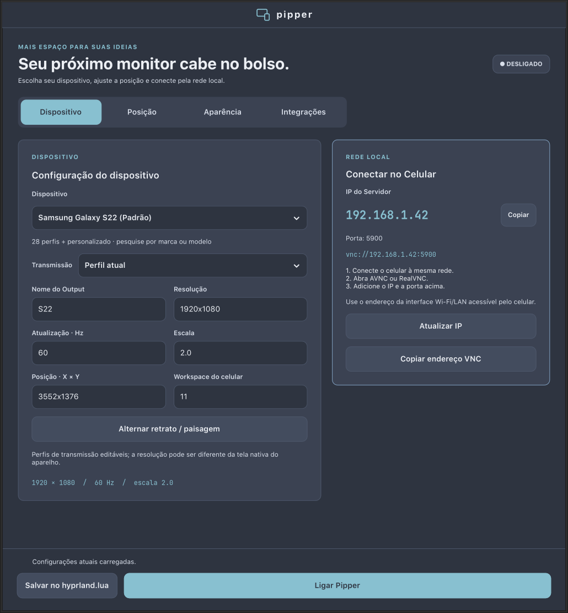
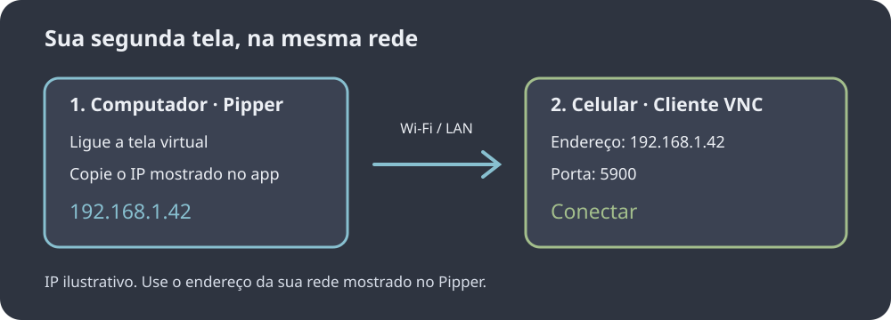
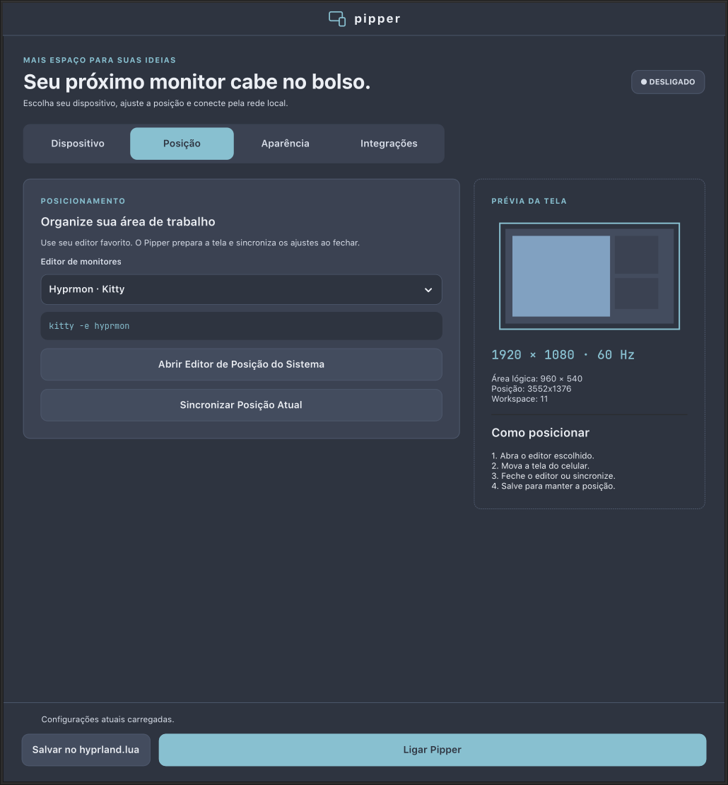
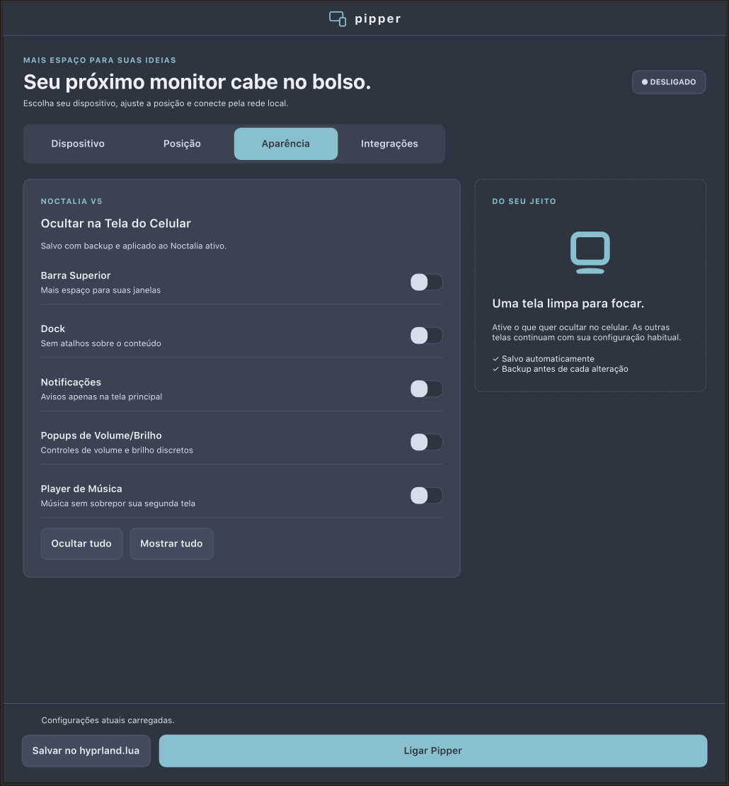
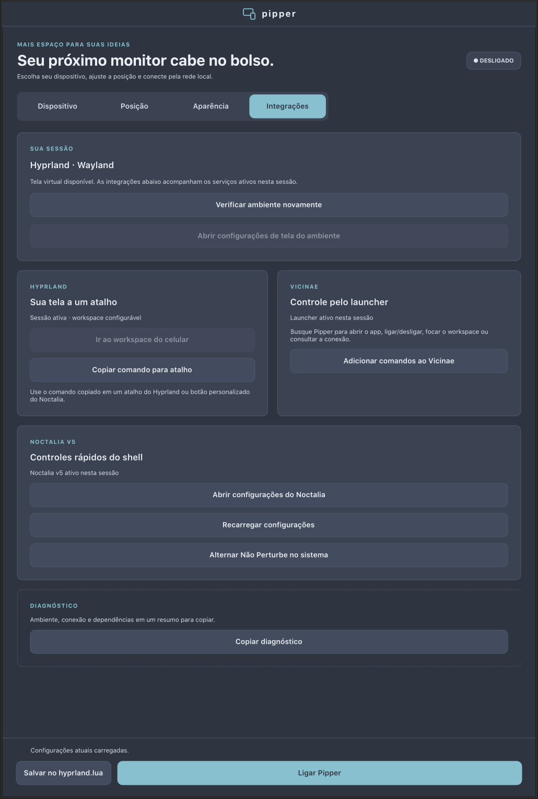

<p align="center"></p>

# Pipper

Transforme seu celular em uma segunda tela sem fio no **Hyprland**, usando wayvnc. Interface GTK4 em português, visual Nord, 29 opções de dispositivos e workspace próprio para o celular — **11 por padrão**.



## Instalar no Arch Linux

Requer uma sessão **Hyprland 0.55+ em Wayland**. Noctalia v5 e Vicinae são opcionais. Os controles de cada integração só ficam disponíveis quando o serviço está ativo na sessão. Outros ambientes podem abrir a interface, mas a criação da tela virtual depende do Hyprland.

Na pasta do projeto, instale as dependências e construa o pacote como usuário comum:

```bash
sudo pacman -S --needed base-devel python-build python-installer python-setuptools python-wheel python-gobject python-cairo gtk4 python-tomlkit wayvnc hyprland desktop-file-utils
python3 scripts/build_arch.py
sudo pacman -U dist/arch/pipper-0.1.0-1-any.pkg.tar.zst
pipper
```

O construtor gera o pacote em `dist/arch/`; a instalação só acontece com o comando `pacman -U`. O pacote inclui comando, entrada no menu e ícones. Para mostrar QR Code, instale também `python-qrcode`.

[Guia de empacotamento e testes](docs/PACKAGING.md) · [Preparar seu GitHub e uma release](docs/PUBLISHING.md)

## Tutorial ilustrado

### 1. Escolha o celular e ligue a tela

Na aba **Dispositivo**, pesquise seu modelo ou selecione o perfil personalizado. Ajuste resolução, escala e **Workspace do celular**. Os perfis são sugestões de transmissão editáveis; não representam necessariamente a resolução física do aparelho.

Clique em **Ligar Pipper** e use o IP da rede local mostrado no aplicativo. Se houver VPN ou várias interfaces, escolha o endereço acessível pelo celular.


### 2. Conecte um cliente VNC no celular

Conecte computador e celular à mesma rede. Em um cliente VNC, como AVNC, informe o **IP do computador** e a porta **5900**. O endereço abaixo é apenas um exemplo. A rede precisa permitir comunicação entre os aparelhos; o Pipper não configura roteador nem firewall.



A conexão padrão usa VNC sem autenticação: utilize uma rede local confiável e não exponha a porta 5900 à internet.

### 3. Posicione a segunda tela

Na aba **Posição**, escolha **Hyprmon · Kitty** para executar `kitty -e hyprmon`, um editor como nwg-displays/wdisplays ou **Comando personalizado**. Instale o editor escolhido separadamente. Se necessário, o aplicativo cria uma tela temporária para o editor.

Organize a tela, feche o editor e confira a posição sincronizada. Use o botão de salvar para manter as regras de monitor e workspace na configuração do Hyprland.



### 4. Ajuste a aparência no Noctalia

Com **Noctalia v5 ativo**, escolha quais elementos devem aparecer na tela do celular: barra, dock, notificações, OSD e outros. As exclusões são gravadas com backup. Sem Noctalia na sessão, esses controles ficam desativados.



### 5. Adicione os comandos ao Vicinae

Abra o Vicinae na mesma sessão. Na aba **Integrações**, use o botão para instalar os comandos. O Pipper cria quatro atalhos, solicita a recarga dos scripts e verifica a indexação. Pesquise **Pipper** no Vicinae para abrir o aplicativo, ligar/desligar, consultar a conexão ou focar o workspace do celular.



As capturas foram feitas no aplicativo GTK real, com serviços simulados e IP ilustrativo. [Script para refazer as imagens](scripts/capture_tutorial.py).

## Posso fechar a janela?

Sim. A transmissão continua após fechar a interface, enquanto a sessão do Hyprland e o processo wayvnc permanecerem ativos. Reabrir o Pipper recupera a sessão. Use **Desligar Pipper** ou `pipper --stop` para encerrar. Isso não mantém a transmissão após desligar o computador ou encerrar a sessão gráfica.

## Comandos úteis

```bash
pipper             # Abrir a interface
pipper --start     # Iniciar com o perfil salvo
pipper --stop      # Encerrar a transmissão
pipper --toggle    # Alternar
pipper --focus     # Ir para o workspace do celular
pipper --status    # Consultar estado
pipper --status --json  # Consultar estado em JSON
pipper --version
```

Execute os comandos dentro da sessão gráfica. Para testar a partir do código, use `python3 pipper` no lugar de `pipper`.

[Detalhes de configuração, backups e diagnóstico](docs/advanced.md) · [Contribuir](CONTRIBUTING.md) · [Changelog](CHANGELOG.md) · [Licença MIT](LICENSE)
