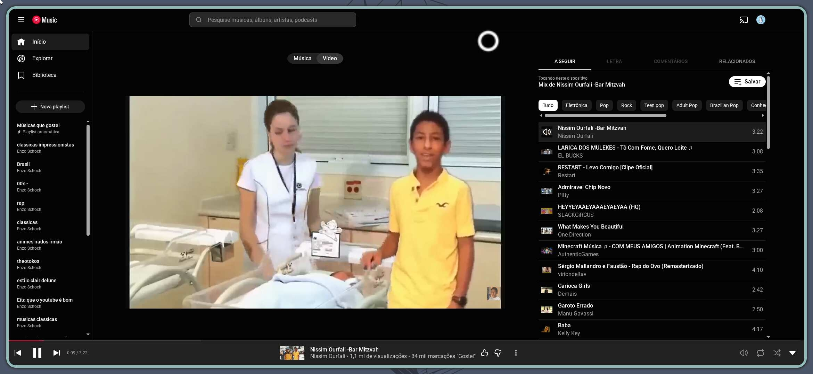
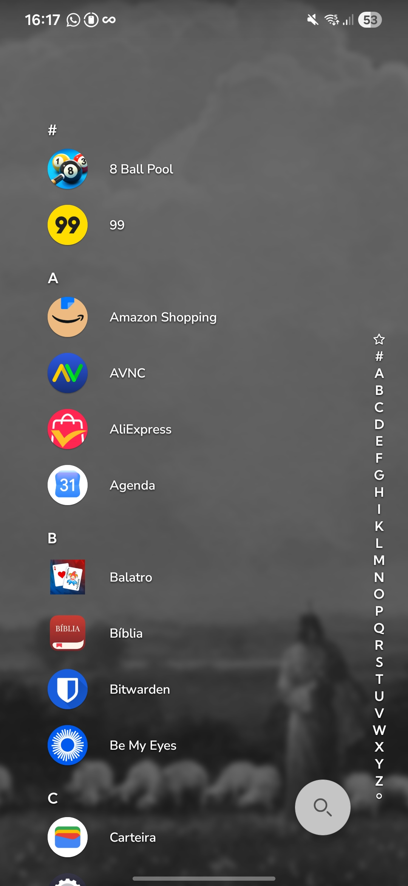
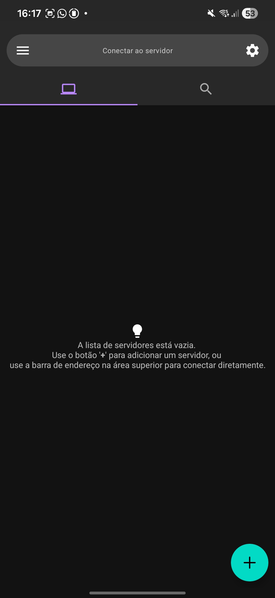
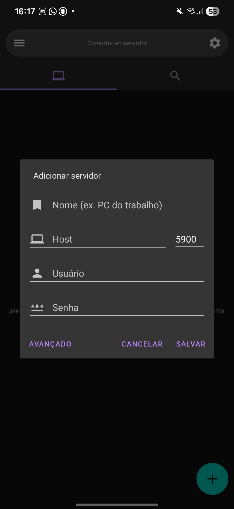
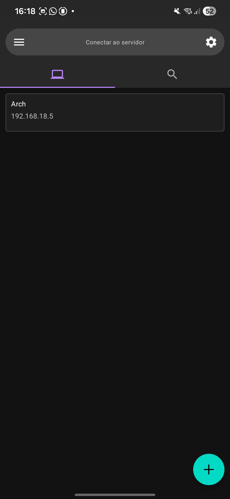

<p align="center"></p>

# Pipper

Transforme seu celular em uma segunda tela sem fio no **Hyprland**, usando wayvnc. Interface GTK4 em português, visual Nord, 29 opções de dispositivos e workspace próprio para o celular — **11 por padrão**.



[Veja o tutorial no celular com as capturas reais do AVNC.](#2-tutorial-no-celular-com-avnc)

## Instalar no Linux

Requer uma sessão **Hyprland 0.55+ em Wayland**. Noctalia v5 e Vicinae são opcionais. Os controles de cada integração só ficam disponíveis quando o serviço está ativo na sessão. Outros ambientes podem abrir a interface, mas a criação da tela virtual depende do Hyprland.

### Instalação automática com curl

Execute em um terminal como usuário comum:

```bash
curl -fsSL https://raw.githubusercontent.com/OnzeXor/pipper/main/scripts/install.sh | bash
```

O mesmo comando detecta a distribuição, baixa uma revisão fixa do código, verifica o SHA-256 e instala as dependências, incluindo QR Code. Quando necessário, pede sua senha de **sudo ou doas** e a confirmação do gerenciador de pacotes. Não precisa de yay nem de conta no AUR.

| Família | Dependências automáticas | Instalação do aplicativo |
| --- | --- | --- |
| Arch, EndeavourOS, Manjaro, CachyOS | `pacman` | Pacote Arch nativo |
| Debian, Ubuntu, Mint, Pop!_OS | `apt-get` | Pasta do usuário |
| Fedora e derivados compatíveis | `dnf` | Pasta do usuário |
| openSUSE | `zypper` | Pasta do usuário |
| Alpine | `apk` | Pasta do usuário |
| Void | `xbps-install` | Pasta do usuário |
| Outras distribuições, NixOS e sistemas imutáveis | Usa dependências já disponíveis | Pasta do usuário, após verificar os requisitos |

Use uma versão da distribuição com **Python 3.11+, PyGObject 3.46+, GTK4 e wayvnc** disponíveis nos repositórios configurados. O instalador informa quando os requisitos não podem ser atendidos; não adiciona repositórios externos. **Não há garantia para toda versão de toda distribuição.** Em NixOS, Fedora Atomic/Silverblue e openSUSE Aeon/MicroOS, as dependências precisam estar disponíveis pela configuração própria do sistema.

Depois, abra **Pipper** no menu ou execute `pipper`. Nas instalações de usuário, também funciona `~/.local/bin/pipper`, mesmo se essa pasta não estiver no `PATH`. Noctalia, Vicinae e editores extras são opcionais. Fora do Arch, o instalador não instala nem troca o compositor: a segunda tela continua exigindo uma sessão Hyprland 0.55+ compatível.

No Arch, o instalador executa `pacman -Syu` e constrói o pacote como usuário comum. No Void, a etapa de dependências usa `xbps-install -Su`. Essas duas rotas incluem a atualização do sistema. Nas outras famílias, instala os pacotes necessários pelo gerenciador local e copia o aplicativo para `${XDG_DATA_HOME:-~/.local/share}/pipper/app`, sem usar `sudo pip` nem modificar o Python do sistema.

Para remover no Arch: `sudo pacman -R pipper`. Nas instalações de usuário: `~/.local/bin/pipper --uninstall`. Preferências e backups são preservados.

Se preferir baixar e conferir o script antes de executar:

```bash
curl -fsSL https://raw.githubusercontent.com/OnzeXor/pipper/main/scripts/install.sh -o /tmp/pipper-install.sh
less /tmp/pipper-install.sh
bash /tmp/pipper-install.sh --dry-run
bash /tmp/pipper-install.sh
```

### Construção manual no Arch Linux

Na pasta do projeto, instale as dependências e construa o pacote como usuário comum:

```bash
sudo pacman -S --needed base-devel python-build python-installer python-setuptools python-wheel python-gobject python-cairo gtk4 python-tomlkit wayvnc hyprland desktop-file-utils
python3 scripts/build_arch.py
sudo pacman -U dist/arch/pipper-0.1.0-1-any.pkg.tar.zst
pipper
```

O construtor gera o pacote em `dist/arch/`; a instalação só acontece com o comando `pacman -U`. O pacote inclui comando, entrada no menu e ícones. Para mostrar QR Code, instale também `python-qrcode`.

[Guia de empacotamento e testes](docs/PACKAGING.md) · [Preparar seu GitHub e uma release](docs/PUBLISHING.md)

Para disponibilizar `yay -S pipper`, veja o [guia de publicação no AUR](docs/AUR.md). A receita está preparada; o comando depende do envio ao AUR.

## Tutorial ilustrado

### 1. Escolha o celular e ligue a tela

Na aba **Dispositivo**, pesquise seu modelo ou selecione o perfil personalizado. Ajuste resolução, escala e **Workspace do celular**. Os perfis são sugestões de transmissão editáveis; não representam necessariamente a resolução física do aparelho.

Clique em **Ligar Pipper** e use o IP da rede local mostrado no aplicativo. Se houver VPN ou várias interfaces, escolha o endereço acessível pelo celular.

<details>
<summary>Ver os campos de configuração no Pipper</summary>


</details>

### 2. Tutorial no celular com AVNC

Com o Pipper ligado, conecte computador e celular à mesma rede. No Android, abra o **AVNC** e siga os passos abaixo. A rede precisa permitir comunicação entre os aparelhos; o Pipper não configura roteador nem firewall.

<table>
  <tr>
    <td width="50%" valign="top">
      <strong>1. Abra o AVNC</strong><br>
      Localize o aplicativo na lista de apps do celular.<br><br>
      
    </td>
    <td width="50%" valign="top">
      <strong>2. Adicione um servidor</strong><br>
      Na tela inicial do AVNC, toque no botão <strong>+</strong> no canto inferior direito.<br><br>
      
    </td>
  </tr>
  <tr>
    <td valign="top">
      <strong>3. Preencha os dados e salve</strong><br>
      Escolha um nome, como <strong>Arch</strong>. Em <strong>Host</strong>, informe o IP mostrado no Pipper; mantenha a porta <strong>5900</strong>. Na configuração padrão do Pipper, deixe <strong>Usuário</strong> e <strong>Senha</strong> vazios. Toque em <strong>Salvar</strong>.<br><br>
      
    </td>
    <td valign="top">
      <strong>4. Toque na conexão salva</strong><br>
      O servidor aparece na lista. Toque nele para conectar à tela virtual.<br><br>
      
    </td>
  </tr>
</table>

O IP nas capturas do celular é o endereço da rede local usada na demonstração. **Use o IP que aparecer no seu Pipper**, pois ele será diferente em outras redes e pode mudar com o tempo.

**5. Confira a segunda tela.** Após conectar, o AVNC mostra a área de trabalho da tela virtual. Você pode girar o celular para usá-lo em paisagem.


**6. Mova uma janela para o workspace do celular.** O padrão é **11**, mas vale o número escolhido no Pipper. A janela aparecerá no AVNC, como neste exemplo de uso:


A conexão padrão usa VNC sem autenticação: utilize uma rede local confiável e não exponha a porta 5900 à internet.

### 3. Posicione a segunda tela

Na aba **Posição**, escolha **Hyprmon · Kitty** para executar `kitty -e hyprmon`, um editor como nwg-displays/wdisplays ou **Comando personalizado**. Instale o editor escolhido separadamente. Se necessário, o aplicativo cria uma tela temporária para o editor.

Organize a tela, feche o editor e confira a posição sincronizada. Use o botão de salvar para manter as regras de monitor e workspace na configuração do Hyprland.


### 4. Ajuste a aparência no Noctalia

Com **Noctalia v5 ativo**, escolha quais elementos devem aparecer na tela do celular: barra, dock, notificações, OSD e outros. As exclusões são gravadas com backup. Sem Noctalia na sessão, esses controles ficam desativados.


### 5. Adicione os comandos ao Vicinae

Abra o Vicinae na mesma sessão. Na aba **Integrações**, use o botão para instalar os comandos. O Pipper cria quatro atalhos, solicita a recarga dos scripts e verifica a indexação. Pesquise **Pipper** no Vicinae para abrir o aplicativo, ligar/desligar, consultar a conexão ou focar o workspace do celular.


As capturas do Pipper foram feitas no aplicativo GTK real, com serviços simulados e IP ilustrativo. [Script para refazer as imagens do desktop](scripts/capture_tutorial.py). As capturas do AVNC foram feitas no celular durante uma conexão real.

## Posso fechar a janela?

Sim. A transmissão continua após fechar a interface, enquanto a sessão do Hyprland e o processo wayvnc permanecerem ativos. Reabrir o Pipper recupera a sessão. Use **Desligar Pipper** ou `pipper --stop` para encerrar. Isso não mantém a transmissão após desligar o computador ou encerrar a sessão gráfica.

## Comandos úteis

```bash
pipper             # Abrir a interface
pipper --start     # Iniciar com o perfil salvo
pipper --stop      # Encerrar a transmissão
pipper --toggle    # Alternar
pipper --focus     # Ir para o workspace do celular
pipper --status    # Consultar estado
pipper --status --json  # Consultar estado em JSON
pipper --version
```

Execute os comandos dentro da sessão gráfica. Para testar a partir do código, use `python3 pipper` no lugar de `pipper`.

[Detalhes de configuração, backups e diagnóstico](docs/advanced.md) · [Contribuir](CONTRIBUTING.md) · [Changelog](CHANGELOG.md) · [Licença MIT](LICENSE)
